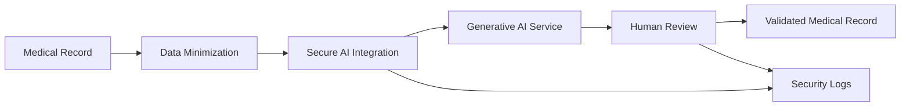

# Healthcare AI Data-Flow Diagram

## 1. Purpose

This document maps the data flow of the fictional Generative AI Medical Report Summarization Assistant.

The objective is to identify:

- the systems and actors involved;
- the personal and health data processed;
- the main storage and transfer points;
- third-party dependencies;
- privacy and cybersecurity risks;
- the controls required at each stage.

## 2. High-Level Data Flow

## 3. Data-Flow Stages

### Stage 1: Medical Report Selection

An authorized healthcare professional selects a medical report from the Electronic Medical Record system.

**Data processed:**

- Patient identifier
- Medical history
- Diagnoses
- Test results
- Prescriptions
- Treatments
- Clinical notes

**Key controls:**

- Multi-factor authentication
- Role-based access control
- Least-privilege access
- Access logging
- Periodic access reviews

### Stage 2: Data Minimization and Pseudonymization

Direct identifiers and unnecessary information are removed before the report is transmitted to the AI service.

**Data to remove when possible:**

- Name and surname
- Postal address
- Email address
- Phone number
- National or insurance identifier
- Exact date of birth
- Information unrelated to the summarization task

**Key controls:**

- Automated identifier detection
- Pseudonymous patient ID
- Data-loss prevention rules
- Validation of the minimized document
- Processing limited to relevant report sections

### Stage 3: Secure AI Integration Layer

A controlled integration layer sends the minimized document to the approved enterprise AI service.

**Key controls:**

- Encryption in transit
- API authentication
- Secrets management
- Input validation
- Prompt-injection filtering
- Rate limiting
- Environment separation
- Logging without unnecessary medical content

### Stage 4: Enterprise Generative AI Processing

The enterprise AI service generates a preliminary medical summary.

**Key questions:**

- Are prompts or outputs retained?
- Are customer data used for model training?
- Where are data stored and processed?
- Which subprocessors are involved?
- Can retention be disabled?
- How are incidents reported?
- Can deletion be demonstrated?

**Key controls:**

- Contractual prohibition on model training with customer data
- Approved data-hosting location
- Encryption at rest
- Tenant isolation
- Defined retention period
- Subprocessor review
- Security and privacy due diligence

### Stage 5: AI Output Validation

The AI-generated summary is presented to an authorized healthcare professional.

The professional must compare the summary with the original medical report.

**Key controls:**

- Clear AI-generated content label
- Mandatory human review
- Access to the original source
- Prohibition of automatic insertion
- Correction and rejection capability
- Validation timestamp
- Identity of the reviewer
- Traceability of modifications

### Stage 6: Validated Record Storage

Only the validated version may be added to the patient's medical record.

**Key controls:**

- Integrity protection
- Version history
- Authorized write access
- Audit trail
- Retention aligned with medical-record requirements
- Secure deletion of rejected drafts

### Stage 7: Monitoring and Audit

Security, privacy and operational events are sent to approved monitoring systems.

**Events to monitor:**

- Failed authentication attempts
- Unauthorized access attempts
- Large-volume processing
- Prompt-injection attempts
- Unusual export activity
- Model errors
- Rejected summaries
- Critical corrections
- Service availability incidents

## 4. Trust Boundaries

The main trust boundaries are:

1. Between the healthcare professional and the Electronic Medical Record system.
2. Between the Electronic Medical Record system and the AI integration layer.
3. Between the healthcare organization and the external AI provider.
4. Between the AI-generated output and the validated medical record.
5. Between operational systems and monitoring platforms.

Each boundary requires authentication, encryption, authorization, logging and documented accountability.

## 5. Main Data-Flow Risks

| Data-Flow Stage | Risk | Potential Impact | Recommended Control |
|---|---|---|---|
| Medical report selection | Unauthorized record access | Health-data breach | MFA, RBAC, access review and logging |
| Data minimization | Direct identifiers remain in the document | Patient re-identification | Automated detection and manual verification |
| AI integration layer | API key compromise | Unauthorized processing or data exposure | Secrets vault, key rotation and least privilege |
| AI provider | Prompt retention or reuse for training | Loss of confidentiality and control | Contractual restrictions and no-retention configuration |
| AI processing | Prompt injection | Manipulated or unauthorized output | Input filtering and adversarial testing |
| AI-generated summary | Hallucination or omission | Incorrect clinical information | Mandatory professional validation |
| Record storage | Unvalidated output stored automatically | Integrity and patient-safety risk | Prohibit automatic insertion |
| Audit logging | Medical content exposed in logs | Secondary data breach | Log minimization and restricted access |
| International transfer | Data processed outside approved regions | Regulatory and contractual risk | Transfer assessment and regional processing |
| Model update | Performance changes without validation | Undetected quality degradation | Change control and regression testing |

## 6. Preliminary Conclusion

The data flow includes several high-risk processing stages because the solution handles sensitive health information and relies on a Generative AI service.

Deployment should be conditional upon:

- effective data minimization;
- use of an approved enterprise AI environment;
- strict access controls;
- mandatory human validation;
- security monitoring;
- supplier due diligence;
- documented retention rules;
- completion of privacy, security and regulatory assessments.
